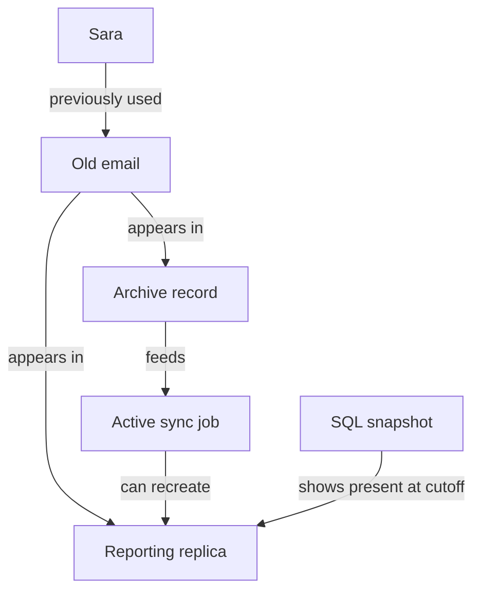
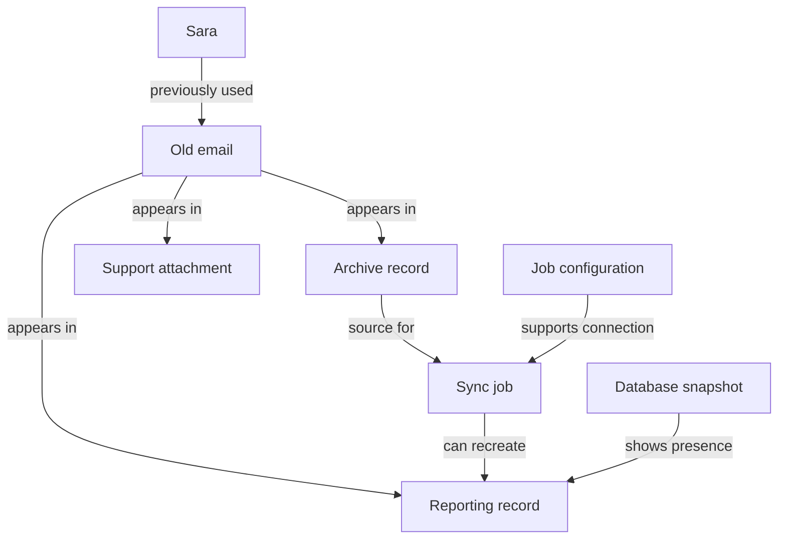

# GhostTrace — Planning Conversation and Agreed Architecture

## Source and scope

Source: the user's planning conversation with ChatGPT Work, dated October 25, 2026.

This document copies the complete user and assistant messages in the selected architecture-planning exchanges below, in their original order. It is a selected conversation transcript, not the entire chat. The opening research summary, environment troubleshooting, implementation-prompt logistics, and transcript-management discussions are excluded. Original citation markers are retained as conversation text; their reference IDs belong to the original chat.

Earlier assistant suggestions are preserved even where they were later simplified or deferred. The agreed architecture at the end identifies the final scope. This planning conversation is separate from Codex's implementation conversation. No original message timestamps or model identifiers have been invented.

---

## Exchange 1 — The agent's role as a story

### User

Give me a workflow as to what is the request and where our agent sits as a story

### Assistant

Imagine **Sara is a customer of Northstar Shop**, an online store.

**1. Sara makes a request**

She sends customer support a message:

> “Please delete my account and all personal information you hold about me.”

This is the **customer’s deletion request**, which becomes one case our agent must investigate.

**2. The company runs its existing deletion process**

Northstar’s account service deletes Sara’s profile from its main database. Its dashboard marks the request **“Complete.”**

However, Sara’s information might still exist elsewhere.

**3. Our agent audits that claim**

**Our agent sits after the company’s deletion process, checking whether the request was actually fulfilled.**

It receives Sara’s request and the supplied company records: identity history, activity logs, database snapshots, documents, screenshots, and deletion policies.

**4. The agent follows Sara’s trail**

It discovers that Sara previously used another email address. Searching both identifiers reveals:

- Her main account was deleted.
- A support attachment still contains her phone number.
- A reporting database still contains her old email.
- An active synchronization job could copy her information back.
- An invoice must remain under the supplied policy, but certain identifying fields must be removed.

These are illustrative findings; the actual decisions come from the dataset.

**5. The agent produces its verdict and plan**

It returns **`INCOMPLETE`**, with evidence explaining why.

Its ordered plan says to disable the relevant synchronization flow, remove or sanitize the affected records according to policy, and then verify the required state.

**6. The result goes into our submission**

For this challenge, **our agent investigates and produces the plan; it does not actually delete data from a live company.** Its findings, proposed actions, and verification checks become Sara’s row in `output.csv`.

Think of its role as an **independent auditor between “our system says deletion succeeded” and “we have evidence that deletion is complete.”**

---

## Exchange 2 — Database access and room for different approaches

### User

So now in terms of the challenge we are given 518 such requests but what about the access to database, do we have that to verify and also we just need to be correct on these 518 requests. Also now that i think about it, there are so many people in this challenge, how come my project will be any different than theirs when everyones agent is working on the same requests and thinks similarly, is there room for abstractions and multiple approaches

### Assistant

**Yes, we get database evidence, but through supplied snapshots rather than access to a live company database.**

The dataset includes SQLite-compatible `.sql` exports representing databases and replicas. Our code can load them into local SQLite databases and query them. Other evidence comes from logs, PDFs, screenshots, and JSON files. We reconstruct what was true at each request’s `audit_at` cutoff. genui{"citation":{"ref":"turn5view1"}}

For example, we could query a snapshot and discover: “Sara is absent from the primary database, but her old email remains in the reporting replica.”

**Are we just trying to answer the 518 requests correctly?**

For the predictions submission, yes: we produce one answer per request, and HackerRank compares those answers against hidden canonical answers.

But the overall competition also evaluates our **code, development transcript, and interview**. We must build a reusable solution without hardcoded case answers, evaluate it against the 32 public samples, and create additional test cases. The interview may probe our understanding using hidden cases. genui{"citation":{"ref":"turn4view1"}}

So the goal is to build a method that correctly solves those requests and that we can explain and defend.

**Where can our solution differ?**

You’re right that everyone receives the same problem. **Correct outputs should largely converge. The room for distinction is in how reliably and efficiently we derive them.**

There are several possible architectures:

| Approach | How it works | Main tradeoff |
|---|---|---|
| LLM investigator | A model searches evidence using tools and reasons through each case | Flexible, but may miss evidence or make inconsistent decisions |
| Structured pipeline | Code extracts evidence, resolves identities, applies policies, and produces steps | Predictable, but unfamiliar evidence can be difficult |
| Hybrid system | Models interpret language and images; code handles structured reasoning and validation | Requires clear boundaries between interpretation and decision-making |

Those are our design options, rather than organizer-prescribed architectures.

There is also room for **different abstractions**. We could represent the problem as:

- **An identity graph:** connects a person to old emails, phone numbers, accounts, and records.
- **A timeline:** tracks when records were deleted, copied, restored, or observed.
- **A policy engine:** determines the required treatment for each record.
- **A dependency graph:** captures which processes must stop before cleanup can succeed.

These can work together in one system.

My proposed distinguishing idea is to treat **deletion completeness as something the system must prove**. Every verdict would trace back to evidence, every relevant policy requirement would have a check, and every recreation risk would have a corresponding remedy.

That gives us measurable advantages to pursue: fewer missed records, correct handling of conflicting evidence, reproducible outputs, and lower model cost. **Our strongest differentiator would be demonstrated reliability, supported by evaluation results.**

---

## Exchange 3 — MCP, OCR, knowledge graphs, and an ambitious initial design

### User

Can we use MCPs so we dont rely on the LLM to extract and search evidence from images. Think about an architecture that no one is gonna use and suggest me that. I also love the idea of a knowledge graph as it becomes easier to visualise for the user as well

### Assistant

**Yes. We can move extraction and search into tools exposed through MCP.** The distinction is that MCP connects the agent to those tools; the OCR engine, database queries, and search index do the work. MCP itself doesn’t read images. genui{"citation":{"ref":"turn6search3"}}

I can’t promise nobody else will use a similar architecture. But I’d propose something more distinctive than a model reading files and issuing a verdict: **a temporal knowledge graph with a deletion verifier and a resurrection simulator.**

**1. Extract evidence once, then make it searchable**

We build one custom Evidence MCP server with a few focused tools:

| Tool | What performs the work |
|---|---|
| `extract_evidence(file_id)` | File parsers for structured data; OCR for images and scanned pages |
| `search_identifiers(identifiers, cutoff)` | Exact identifier indexes and full-text search |
| `resolve_identity(email, cutoff)` | Traversal through current and historical identity records |
| `trace_recreation_paths(user_id, cutoff)` | Graph traversal through sync, import, and restore relationships |
| `check_policy(case_id)` | Code evaluating the supplied deletion rules |

For image text, an OCR engine such as PaddleOCR can return **recognized text, bounding boxes, and confidence scores** without a general-purpose LLM extracting it. genui{"citation":{"ref":"turn6search4"}} SQLite FTS5 can provide full-text search over extracted documents. genui{"citation":{"ref":"turn6search1"}}

We preserve the original file reference and location behind every extracted fact. Low-confidence OCR triggers another extraction attempt or a targeted vision fallback. **Failing to find text cannot establish that personal data is absent.**

**2. Build a graph of observations, identities, and processes**

The graph would connect:

- People to current and historical identifiers.
- Identifiers to records across systems.
- Records to the evidence supporting their observed state.
- Sync and restore processes to their sources and destinations.
- Policies to the required treatment of records.

Every observation carries its time and provenance. A dashboard saying “deleted” and a database snapshot showing “present” remain separate observations until our reconstruction resolves them.

An illustrative part of Sara’s graph:



**3. Add the distinctive part: test how data could return**

After identifying the required cleanup, we simulate its effect on a **copy of the graph**.

Suppose the proposed plan removes the reporting record. The simulator asks:

> “Can any surviving source still reach that system through an active data flow?”

If the archive and sync job remain, it finds a path that could recreate Sara’s data. The verifier reports that the plan still leaves a recreation risk.

This is a bounded simulation of the supplied evidence, rather than executing company systems. It can expose weaknesses in a plan; it cannot prove facts absent from the dataset.

**4. Generate the verdict from explicit checks**

The verifier checks the relevant policy obligations: required deletion or sanitization, permitted retention, and blocked recreation paths. Code then generates the challenge’s exact operations and ordering.

The LLM handles ambiguous request language, difficult evidence interpretation, and explanations. **The pipeline controls evidence coverage and validates the final answer.**

For the user, the graph becomes an explanation interface: click a finding to inspect its source, move the audit-time slider, or preview which recreation paths a proposed action blocks.

My recommendation is to pursue this architecture with a small implementation: **one MCP server, a temporal graph, and a deterministic verifier.** Build the resurrection simulation next, then add visualization once the audited outputs are working.

---

## Exchange 4 — The user challenges unnecessary complexity

### User

You know I haven't worked with this type of data and so explain the concepts in a little layman terms from now on. Also tell me whether the MCP server and temporal graphs are actually needed cause I don't want to do something that is not worthwhile and increases complexity. If it does significantly improve our work, then we should utilize it. If you have any other better ideas, let me know.

### Assistant

Understood. I’ll introduce unfamiliar terms in plain language from now on. **My earlier proposal added more complexity than we currently have evidence to justify.**

We should build the smallest reliable solution, then add features when they solve a demonstrated problem.

| Component | What it means | Do we need it? |
|---|---|---|
| **MCP server** | A standard way for an agent to call our tools | **Optional.** Our program can call the same Python functions directly. MCP doesn’t make extraction more accurate. |
| **Knowledge graph** | A map connecting people, identifiers, records, and systems | **Potentially useful**, especially for following old identities and explaining findings. |
| **Temporal graph** | That same map, with dates recording when things were true | **We need the dates.** We don’t necessarily need a specialized graph system. |
| **Resurrection simulator** | A model of how deleted data might return | **Defer it.** First, check the supplied evidence for active copying and restore processes. |

MCP becomes worthwhile if we want several applications or agents to reuse our tools. For this challenge, **ordinary functions are enough**, and we can expose them through MCP later without rebuilding the underlying logic.

A graph also doesn’t require a separate graph database. We can store relationships in ordinary tables:

> Sara → previously used → old@email.com  
> old@email.com → appears in → support attachment  
> Support attachment → observed on → October 20

Our program can follow these connections, and a visual interface can draw them later. **The useful part is correctly recording relationships and dates; the drawing is an additional view.**

I recommend this simpler workflow:

1. **Read the evidence once.** Read database snapshots and structured files directly. Use OCR, software that recognizes text in pictures, for screenshots and scanned pages.
2. **Build a searchable evidence collection.** Store extracted text alongside its source and date.
3. **Find the person’s identity history.** Collect their relevant old and current identifiers, with evidence for each connection.
4. **Inspect their records at the audit cutoff.** Check what remained and which processes could copy it back.
5. **Apply the supplied policy.** Determine which records need deletion, changes, or retention.
6. **Produce and validate the required CSV.**

The most worthwhile addition would be an **evidence checklist for every case**. It records what we checked, what we found, and what remains uncertain. That helps prevent the dangerous assumption that “we didn’t find anything” means “everything was deleted.”

We should evaluate this version against the **32 labelled samples**. If failures show that following relationships is difficult, we strengthen the graph logic. If image interpretation fails, we improve extraction. That gives each added component a clear purpose and measurable benefit.


---

## Exchange 5 — The user asks for a substantial, defensible MVP

### User

But when I need to defend my project against AI judge, how will it rate me higher if my architecture is similar to everyone. Like all of us are gonna read and extract info from images, and other sources and then save that somewhere and then agent evaluates it and passes the final verdict. I want an MVP and it should be bigger than a checklist.

### Assistant

**Then our MVP should be a deletion investigation workbench: a system that explains how deletion failed and lets someone test whether a proposed fix would work.** I reduced the previous scope too far toward producing the CSV.

There is room for this in the judging. HackerRank evaluates architecture, robustness, output accuracy, and your technical judgment. Its guidance specifically asks builders to explain which design choices improved their results. An unusual architecture alone doesn’t guarantee a higher score; working features and measured improvements give you something stronger to defend. genui{"citation":{"ref":"turn8view0"}}

I recommend building around **three connected capabilities**.

**1. An interactive investigation map**

Open Sara’s case and see her connected identities, records, systems, and copying processes.

Click a record to see:

- Why we believe it belongs to Sara.
- The original evidence supporting that connection.
- When it was observed.
- What the supplied policy requires us to do.

The graph has an actual job here: it follows connections such as **Sara’s old email → archived record → sync job → reporting database**. The interface displays the same relationships our investigation code uses.

**2. A timeline that explains the failure**

The system reconstructs a sequence such as this illustrative example:

| Time | What happened |
|---|---|
| 10:00 | Main account deleted |
| 10:05 | Workflow reports completion |
| 10:20 | Synchronization job copies an archived record |
| 10:30 | Database snapshot shows Sara’s information present |

Now we can explain: **“The primary deletion succeeded, but a later synchronization recreated the record.”**

We only make that specific claim when the evidence supports the connection. Otherwise, we report a possible recreation path or conflicting observations. That distinction makes the investigation trustworthy.

**3. A “Test this cleanup plan” feature**

This would be our signature interaction.

The user selects a proposed action, such as deleting the reporting record. We apply it to a temporary model of the case and check the remaining relationships.

The system responds:

> “This removes the current copy, but the active synchronization path could recreate it.”

Add the required action to stop that path, and the preview updates. If the user proposes deleting a record that policy requires retaining, the system flags that violation too.

This is a **limited what-if test based on supplied evidence**. It does not run company systems or guarantee that no undiscovered copies exist.

These features share one underlying engine:

**Evidence → dated relationships → policy checks → verdict and remediation plan.**

The required CSV comes from that engine. The graph, timeline, and plan preview make its reasoning inspectable. We can implement this with ordinary Python functions and tables; MCP and a separate graph database can remain optional.

For the interview, our strongest demonstration would be:

> “Here is a case where deletion appeared successful. Our system follows the historical identity, reconstructs the failure, and shows why deleting the remaining copy alone is insufficient.”

Then we support that demonstration with tests: does ignoring old identities miss records? Does ignoring dates accept misleading evidence? Does the plan checker catch an active recreation path?

**That is the MVP I would choose:** a working investigation and cleanup-planning product, with a visual graph serving the reasoning engine. Its differentiation would be something the judge can inspect and test.

---

## Exchange 6 — Timestamps and Gemini's responsibilities

### User

Do we have time information for the timeline?
For the cleanup planning we will need an LLM calling where we have to use Gemini free API key. Right?

### Assistant

**Yes, we have time information for a timeline.** The repository documentation describes:

| Source | What it tells us |
|---|---|
| Deletion request | When deletion was requested, when completion was reported, and the audit cutoff |
| Activity records | Dated deletion, sync, export, backup, and restore events |
| Identity history | Historical changes to the person’s identifying information |
| Evidence manifest | When each evidence file was captured |

We must reconstruct the case using information available **at or before `audit_at`**. genui{"citation":{"ref":"turn5view1"}}

One distinction matters: **a screenshot captured at 10:30 proves what it showed at 10:30; it doesn’t necessarily tell us when that state began.** The timeline should distinguish observed states from recorded events. We haven’t inspected every evidence file yet, so we shouldn’t promise a complete event history for every case.

**For cleanup planning, Gemini can help, but an LLM call isn’t required for every action.**

For example, once we establish:

> “This record contains prohibited personal information, and the supplied policy requires deletion.”

Code can generate `DELETE_RECORD` and the corresponding verification step. The challenge already defines the permitted operations and their ordering. genui{"citation":{"ref":"turn7view0"}}

My proposed division is:

| Code handles | Gemini helps with |
|---|---|
| Searching identifiers and filtering dates | Understanding ambiguous or multilingual requests |
| Applying clearly defined policy rules | Interpreting difficult document passages |
| Checking cleanup plans and ordering steps | Explaining findings in everyday language |

**We can use your Gemini API key on the free tier**, with a model available to your project. However, free access has model-specific request and token limits. We need to check your actual quota in [Google AI Studio](https://aistudio.google.com/) before assuming it can support all 518 cases plus testing. Limits apply per project, rather than per key. genui{"citation":{"refs":["turn9view1","turn9view2"]}}

We’ll save model responses for reuse and send only relevant evidence, so rerunning a case doesn’t unnecessarily consume the free quota.

---

## Exchange 7 — The user checks the natural-language what-if workflow

### User

What we are essentially doing is that once we are done with the whole process, we simply give the user a suggestion or the verdict, what he should do, and then we have a new feature where we, you know, ask the user for, user wants to ask, like, what if I delete this? Will it work and will it solve my problem? So for that feature, when the user types in that feature, it needs to be processed through an LLM call and then given to our project where we check it, right? So explain that workflow, like the new feature we have added, what will happen.

### Assistant

**Yes. For this feature, Gemini translates the user’s question into a proposed action. Our project then checks the consequences using the evidence, relationships, and policy.**

Imagine the audit found Sara’s information in a reporting database, with an active sync job that could copy it back from an archive.

**1. The user asks a what-if question**

> “What if I delete Sara’s record from the reporting database? Will that solve it?”

The question belongs to Sara’s currently open case, so we already know which person and investigation it concerns.

**2. Gemini interprets the proposed action**

We send Gemini the question and the relevant case context. It translates the sentence into something our code understands:

```json
{
  "action": "DELETE_RECORD",
  "system_id": "reporting_database",
  "resource_id": "record_42"
}
```

These identifiers must come from the case data. If “that record” could mean several records, the interface asks the user to select one.

**3. Our code validates the proposal**

Before testing it, we check:

- Does this record actually exist in the case?
- Is this action supported?
- Does the supplied policy permit deleting it?

Gemini’s interpretation is treated as a proposal that needs checking.

**4. We apply the action to a temporary copy of the case**

We pretend `record_42` has been deleted and check the remaining records and connections.

**Nothing in the original evidence or any live database changes.**

**5. The engine checks what remains unresolved**

It discovers that the archive still contains Sara’s data and the sync job remains active.

The result is:

> “Deleting this record removes the current copy, but does not resolve the case. The active sync job could recreate it from the archive.”

The interface highlights that path on the graph and shows the additional policy-required actions.

**6. The user tests a revised plan**

> “What if I also disable that sync job?”

We repeat the process, evaluating the combined proposal. The answer identifies which issues would be resolved and which would remain, **within the limits of the supplied evidence**.

We can generate the explanation directly from the engine’s findings; a second Gemini call is optional if we want more conversational wording.

So the feature has a clear division: **Gemini understands what the user wants to try; our engine tests it; the interface explains the result.** The original audit verdict remains separate from this hypothetical preview.

---

## Exchange 8 — Graph structure, graph views, and the optional interface

### User

What about the graph? Like, will we make a proper graph? And will we, like, have the UI to show it to the user or for the product? Like, I want— have they asked us to make a whole website or a deployed website? The HackerRank hackathon, like, have they asked us for a deployed UI or a deployed app? So tell me more about how you are going to show the graph and how you are going to make the graph. And what will be the nodes of the graph? Like what will they represent? And will we have separate graphs for each record?

### Assistant

**Yes, we can build a proper interactive graph and a UI around it. HackerRank does not require a deployed website or app in its published deliverables.** It requires runnable code, the predictions CSV, development transcript, evaluation reports, and the interview. A UI would be an additional product feature. genui{"citation":{"ref":"turn11view1"}}

My proposal is a **web app that initially runs locally on your laptop**, opening in your browser. Deployment can come later.

**What would the graph contain?**

A graph consists of **nodes**, the things we investigate, and **edges**, the labelled connections between them.

| Node type | Represents | Example |
|---|---|---|
| Person | The customer being investigated | Sara |
| Identifier | Something identifying that person | Old email, current phone number |
| Record or stored copy | A particular piece of their data | Account row, support attachment, backup copy |
| Process | Something that moves or recreates data | Sync job, restore process |
| Evidence | The source supporting an observation | SQL snapshot, screenshot, log entry |

We can display systems, such as “Reporting database,” as **containers grouping their records**. Policy requirements can appear in the details panel when you select a record, keeping the main graph readable.

Here is an illustrative case:



**How would we build it?**

Our Python code reads the evidence and creates a list of nodes and connections. For example:

> Node: `archive_record_12`  
> Connection: `archive_record_12` is a source for `sync_job_4`  
> Supporting evidence: `file_27`  
> Observed time: October 20

A graph drawing library displays those connections in the browser. The investigation engine uses the same relationships when following identities and checking recreation paths.

We only add connections supported by evidence. A shared name alone, for example, should not automatically connect a record to Sara.

**Would every record have a separate graph?**

**Each record becomes a node. Each deletion request gets its own focused graph view.**

We maintain one underlying collection of relationships, but when you open Sara’s request, you see only the relevant part at that request’s audit cutoff. This avoids displaying all 518 cases together.

Two requests concerning the same person can reuse relationships while showing different states at different audit times.

**What would the user see?**

- **Left:** request list and verdicts.
- **Centre:** zoomable, clickable graph.
- **Right:** selected record’s evidence, observed state, and required treatment.
- **Below:** timeline and the what-if question box.

Colour would communicate meaning: red for a policy violation, green for verified compliance, grey for uncertainty, and blue for a proposed change.

When the user tests “What if I delete this record?”, the graph shows a **labelled hypothetical preview**. It highlights the affected record and any surviving recreation path. The original evidence remains available.

That gives us a graph that supports investigation, explanation, and cleanup planning throughout the product.


---

## Exchange 9 — The user challenges the need for a website and prioritizes the architecture

### User

If they don't require a deployed website, so why are we creating one? Like why not just give the AI judge the code and let it analyze our architecture? Because mainly the questions are gonna be from architecture. Or even if we want to, you know, create a browser, we could simply run it locally because the AI judge will not have any URL or any deployed URL. So why do we need one? And if it's not gonna have a UI, so then our only chance of winning is through the architecture, not the UI, right? So do you have any idea how the AI agent is gonna— how the AI judge is gonna, you know, evaluate a project? And what type of questions is it gonna ask when we give it the code? Like you have some idea of what the code is gonna look like. So we're gonna give it the code and the chat, the TXT of the logs of Codex. So it's gonna ask me questions, right? So tell me about that.

### Assistant

**Yes, we can submit the code without building a UI or deploying anything.** I introduced the UI as a product option; it is not a submission requirement.

The knowledge graph and what-if feature can still exist as working code, accessible through terminal commands. A visual interface can be added later if it helps us inspect the results.

**Architecture is only one part of the score.** HackerRank’s current general documentation lists:

| Component | Weight | What it assesses |
|---|---:|---|
| Code | 30% | Architecture, prompts, tools, robustness, engineering quality |
| Predictions | 30% | Whether the answers are correct |
| Interview | 30% | Your understanding, judgment, and explanations |
| AI conversation log | 10% | How you directed, tested, and improved the build |

It notes that weights can vary by edition. There is no separate UI category in this published breakdown. genui{"citation":{"ref":"turn12view0"}}

**How does the judge evaluate the project?**

There are two related activities:

1. **Submission assessment:** the code assessment examines the source and README, while the output assessment checks the submitted predictions. HackerRank says implemented behaviour matters; describing a feature in the README does not earn credit for implementing it.
2. **Your interview:** the AI interviewer reviews your submission and asks you to explain its architecture, implementation, failures, evaluation, and your work with the coding assistant. Its published description includes a technical examination of your code. genui{"citation":{"ref":"turn12view1"}}

We should not assume it will visit a website, watch our local interface, or execute every optional feature. We should make important behaviour clear in the source, tests, and written evaluation.

**What might it ask about our proposed project?**

These are examples I would prepare you for, rather than confirmed interview questions:

| Possible question | What you would need to explain |
|---|---|
| “Walk me through one request.” | How it moves from request text to evidence, policy checks, and output |
| “Why use a graph?” | How following relationships finds historical identifiers and recreation paths |
| “What does Gemini decide?” | Which interpretation tasks it handles and which decisions code checks |
| “What if OCR misreads an email?” | How we detect uncertainty, retry extraction, and avoid false matches |
| “The log says deleted, but a snapshot shows present. What happens?” | How time, source, and conflicting observations affect reconstruction |
| “How does your what-if feature work?” | How proposed actions change a temporary case model and leave original evidence untouched |
| “How do you know the graph helped?” | A comparison showing errors with and without relationship traversal |
| “What happens when Gemini’s quota runs out?” | Which work continues, what is saved, and what requires retrying |
| “What did Codex get wrong?” | A real example of your review, correction, and subsequent verification |

**The Codex log helps establish your ownership.** It shows the instructions you gave, choices you challenged, failures you inspected, and improvements you requested. HackerRank explicitly values this development trail. genui{"citation":{"ref":"turn12view2"}}

My recommendation is to **prioritize the audit engine, graph reasoning, what-if checker, and meaningful tests; defer the UI**. Then we prepare your interview around the actual implementation, tracing real cases through the code. That gives you concrete behaviour and results to defend.

---

## Exchange 10 — Project name

### User

Now decide a name for the project and I will create the repo

### Assistant

**GhostTrace**

It captures both tracing personal data across systems and finding paths that could bring deleted data back.

**GitHub repo:** `ghosttrace`

**Description:** An AI deletion audit agent with evidence graphs, timeline reconstruction, and what-if cleanup analysis.

---

# Agreed Architecture — Final Planning Summary

This section is a newly written summary of the decisions reached through the conversation and transferred to Codex through the user's planning prompts. It is not a quoted historical conversation and is not a claim that all features are implemented.

## 1. Product and scope

**GhostTrace** is an evidence-backed deletion audit and cleanup-planning engine. It investigates the supplied cases, explains the required treatment of personal data, and supports hypothetical cleanup questions.

The user wanted a substantial, defensible MVP with useful graph reasoning and what-if analysis, while explicitly questioning components that added complexity without demonstrated benefit.

The personal repository subsequently created by the user is:
https://github.com/khanarmaghanrasheed-18/GhostTrace-Hackerrank

The implementation work observed during this planning chat was on the personal repository's `work` branch. That observation does not establish the checkout's current state; inspect Git and the code before continuing.

## 2. Input and core audit

Use participant-facing files under `dataset/` only. Audit the 518 required requests. Use the 32 public labelled samples for evaluation, keeping expected answers separate from prediction logic.

For each case:
1. Determine whether the request actually authorizes deletion.
2. Resolve the subject's current and historical identifiers using grounded connections.
3. Find the relevant records and processes.
4. Reconstruct their state at `audit_at`.
5. Apply the supplied policy, including required retention and account tombstones.
6. Produce the prescribed verdict, findings, remediation, and verification steps.

Reported completion messages and successful operation results are claims, not automatic proof of the resulting state. Shared names, empty searches, and failed extraction must not become unsupported identity links or evidence of absence.

## 3. Evidence extraction and provenance

Use direct parsing and database queries for structured evidence. Extract embedded PDF text before using OCR for scanned pages or screenshots.

Preserve source IDs, file locations, timestamps, extraction methods, and failures. Cache extraction so files are not processed repeatedly without need.

OCR is not a general-purpose LLM call, but its output can still contain errors. Preserve uncertainty and use retries or targeted interpretation where justified.

## 4. Time and contradictory observations

Keep event time distinct from evidence capture time. Use only evidence permitted by the audit cutoff. Preserve conflicting observations rather than silently choosing a convenient one.

Do not invent events, assume a complete history, or infer causality from timing alone. A supported recreation path is different from proof that a specific recreation event occurred.

## 5. Evidence graph

Use a simple shared collection of dated, evidence-backed relationships. Ordinary Python structures or tables are sufficient; a separate graph database is deferred.

Nodes represent:
- People.
- Current and historical identifiers.
- Records or stored copies.
- Sync, import, and restore processes.
- Supporting evidence.

Systems can group or identify the records they contain. Policy requirements attach to the relevant records and checks.

Graph traversal must contribute to investigation, including historical identity linkage and discovery of supported recreation paths. Each record is a node; each request gets a focused graph view at its own audit cutoff. Do not create 518 unrelated, duplicated graph implementations.

## 6. Timeline

Expose case events and observed states in time order through terminal inspection commands. Preserve the difference between an event and an observation of a state. An interactive slider or browser visualization is deferred.

## 7. What-if cleanup analysis

Support explicit proposed actions and natural-language questions scoped to a selected case.

Natural-language workflow:
1. Gemini interprets the question into structured proposed actions using real case identifiers.
2. Code validates action types, targets, and policy restrictions.
3. Ambiguous targets require clarification; nonexistent targets are rejected.
4. Apply valid proposals to a temporary copy of the case model.
5. Recheck remaining violations, required retention, and supported recreation paths.
6. Explain what the proposal resolves and what remains, with supporting evidence.

Support cumulative proposals and resetting the hypothetical state. Preserve original evidence, original verdicts, and submission output. Never execute deletion on a live company system.

Results are hypothetical and limited to the supplied evidence. Do not claim complete real-world coverage or formal proof of absence. An additional LLM call to word the explanation is optional; the explanation can come directly from checked findings.

## 8. Code and Gemini responsibilities

| Code | Gemini, selectively |
|---|---|
| File parsing, SQL queries, OCR integration, and searches | Ambiguous or multilingual request interpretation |
| Identifier matching and graph traversal | Difficult document or extracted-text interpretation |
| Audit-time filtering and policy enforcement | Translating natural-language what-if questions into proposals |
| Cleanup-plan checks and output validation | Optional conversational explanations grounded in checked results |
| Ordering and final CSV serialization | No independent authority to invent evidence or bypass policy checks |

Use the user's Gemini free-tier API access through secure configuration. Verify actual model availability, credentials, connectivity, and quota rather than assuming they work.

Cache reusable model responses, restrict context to relevant evidence, bound retries or investigation loops, and record actual calls, tokens, failures, and costs. Do not fabricate successful calls or substitute unlabelled simulated responses.

## 9. Complexity and delivery decisions

Keep:
- A modular Python engine.
- Runnable terminal commands.
- Grounded graph relationships.
- Timeline inspection.
- Isolated what-if checks.
- Reproducible evaluation and reports.

Defer:
- An MCP server.
- A separate graph database.
- A website or browser UI.
- Deployment and hosting.
- Simulation of real company infrastructure.

The graph remains a computational structure even without an interactive drawing. Cloud execution is the current development setting; avoid hardcoded laptop paths.

## 10. Output and evaluation

Follow the actual official specification in the repository if a planning example differs from it.

Required output columns:
`case_id,deletion_status,steps_json`

Use exactly the allowed statuses, step fields, phases, operations, states, citation conventions, and ordering. The seven step fields are `step_no`, `phase`, `system_id`, `resource_id`, `operation`, `state`, and `evidence_id`.

Findings and verification proving completed deletion need the required evidence. Proposed remediation and future verification for incomplete deletion use empty evidence references as specified by the challenge.

Evaluate status, full-row, step, field, and sequence accuracy. Add independent cases for non-deletion requests, historical identities, conflicting observations, cutoff handling, retention, and recreation risks. Test what-if isolation, invalid proposals, extraction failures, and model/API failure handling.

Where useful, compare results with and without historical identity traversal or time filtering. Report measured differences honestly, including no improvement. Public-sample success is not hidden-dataset accuracy.

## 11. Implementation sequence and human review

1. Establish a working core ingestion, investigation, policy, and CSV pipeline.
2. Inspect actual failures before adding complexity.
3. Add the graph, timeline, and what-if capabilities.
4. Evaluate, repair supported failure causes, and document limitations.
5. Run the full dataset, document actual usage, and package the required artifacts.
6. Prepare interview explanations grounded in actual functions, tests, and results.

The user is directing scope through review points between milestones. Read the current code and status before executing the next prompt; do not assume a planned component is already implemented.

## 12. Planning provenance and log handling

This planning conversation happened in ChatGPT Work. Codex received the decisions through the user's implementation/planning prompts. No Antigravity implementation took place.

Preserve this document as supplemental planning context, for example at `code/evaluation/planning_transcript.md`, and include it in the submitted code archive if the user chooses to submit it.

Keep the implementation `log.txt` in its prescribed append-only format. Record a normal current import/review entry that references this document. Do not turn these historical excerpts into invented Codex turns, guess missing metadata, or rewrite earlier log entries.

Before the next implementation step, compare the current code and `docs/PLAN.md` against this final summary and report any meaningful mismatch. The official challenge contract remains authoritative for submission details.

